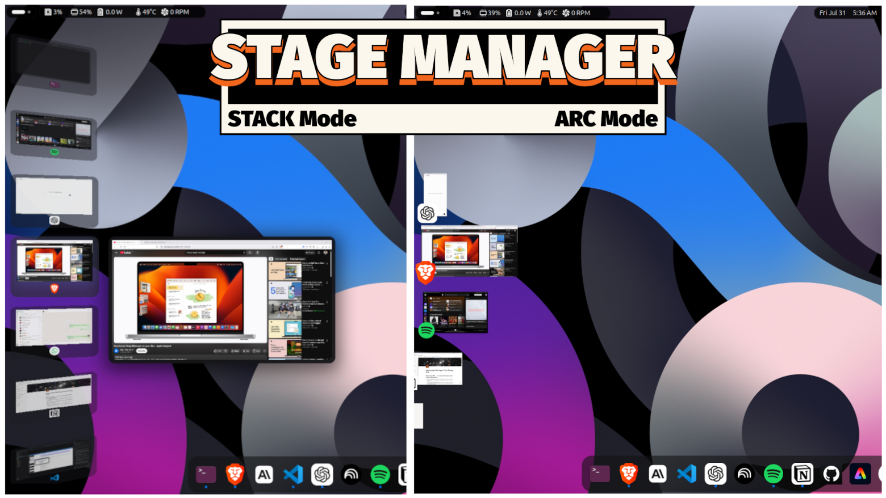
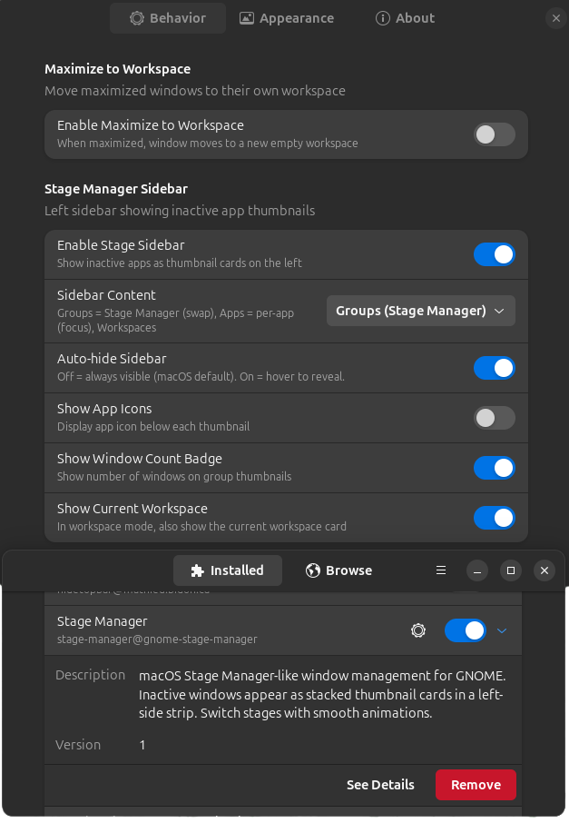
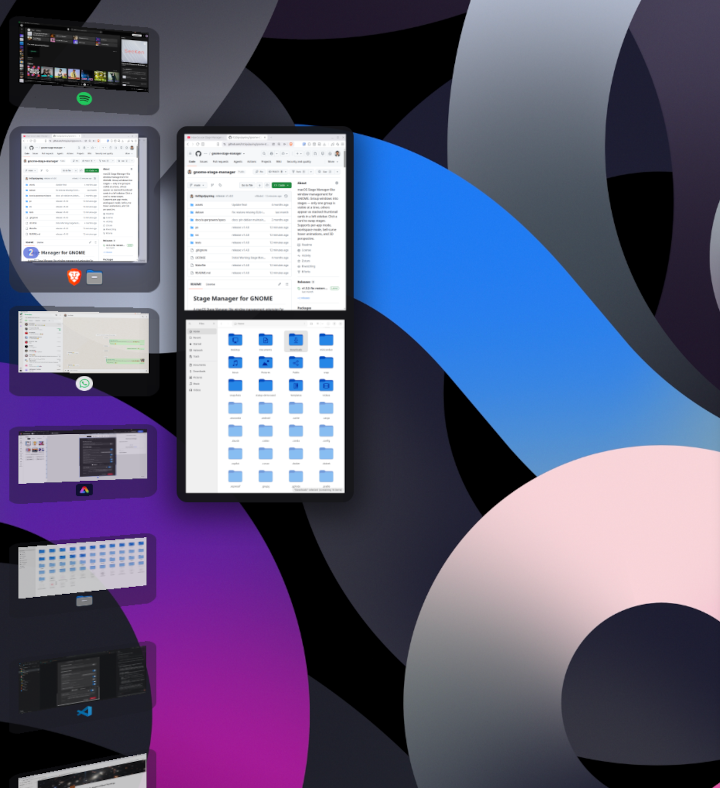

# Stage Manager for Linux

A macOS Stage Manager-like window management extension for GNOME Shell.

Group windows into stages: only one group is visible at a time, others appear as stacked thumbnail cards in a sidebar at the screen edge. Click a card to swap stages. Supports per-app mode, workspace mode, an alternate Arc carousel layout, bell-curve hover animations, and 3D perspective.

- Demo: https://youtu.be/8fnFvYaxUMo
- GNOME Extensions: https://extensions.gnome.org/extension/9528/stage-manager/
- GitHub: https://github.com/itsDigvijaysing/gnome-stage-manager



## What's New in 2.1.0

- **Click the desktop** to park the current stage, like clicking the wallpaper on macOS.
- **The sidebar steps aside** while a window covers it, so that window stays fully clickable.
- **Stages survive the lock screen** and come back exactly as you left them.
- **Optional Show Desktop shortcut.**
- **Arc layout**: one card per window that you group by dragging, plus new hover, overview and visibility options.
- **Many fixes**: closing a minimized window, minimizing or restoring during a workspace switch, dragging files from desktop icons, auto-hide, "Always on Visible Workspace" windows, and maximize-to-workspace with Ubuntu's tiling assistant.
- **Lighter on the GPU**: a hidden sidebar no longer draws, thumbnails are live clones instead of full-size snapshots, and card shadows are smaller.

## Features

- **Stage Manager Groups**: Windows you use together stay grouped. Only the active group is visible; inactive groups appear as stacked thumbnail cards in a sidebar (left, right, or a bottom strip).
- **One-Click Swap**: Click any sidebar card to swap stages. The active group minimizes, the clicked group comes to the foreground.
- **4 Sidebar Modes**: Groups (Stage Manager swap), Apps (per-app focus), Workspaces (switch workspaces), All Windows (every window on every workspace).
- **Click the Desktop**: In Groups mode, clicking the empty desktop parks the current stage as one card, like clicking the wallpaper on macOS. Dragging a file from the desktop icons onto a window does not.
- **Stages Stay Whole**: Restoring a window from the dock or alt-tab brings its whole stage forward instead of pulling that one window out of it.
- **Survives the Lock Screen**: Locking and unlocking keeps your stages, Arc groups and maximized-window origins.
- **Arc Layout**: An alternate sidebar built as a stacked-paper carousel on the left, right, or bottom edge: one card per window that you group by dragging, hover to fan a group out, momentum scrolling, right-click to split a group, an optional persistent mode, and its own keyboard shortcuts.
- **Drag-to-Merge Apps**: In Apps mode (Stack layout), drag one app card onto another to combine them into a single card; a thumbnail follows the pointer while you drag. Right-click a merged card to split it back apart. Independent of Arc Layout's own grouping.
- **Keyboard Shortcuts**: Optional shortcuts to reveal or hide the sidebar and to show the desktop, without moving the mouse to the screen edge. Set them in Preferences → Behavior → Shortcuts; they apply immediately.
- **Maximize Behaviour**: What maximizing a window does. Options are nothing (default), move it to a new empty workspace, or give it a stage of its own with its former stage-mates parked as a card (Stack layout + Groups mode). Only a full maximize counts, not edge tiling. Unmaximizing always returns the window.
- **Bell-Curve Hover Animation**: Hovered card scales up smoothly; only 1-2 neighbors are affected (tight sigma).
- **3D Perspective**: Cards have a configurable Y-axis rotation for a natural depth look, consistent direction for all cards.
- **Stacked Thumbnails**: Groups with multiple windows show fanned-out card stacks with visible back layers, scaled so the stack always fits the sidebar.
- **Live Thumbnails**: Cards are live views of their windows, minimized ones included, and cost no extra memory. A window with nothing to show falls back to its app icon.
- **Window Count Badge**: Optional badge showing how many windows are in each group.
- **Live Previews**: Hover a card to see a larger preview of all windows in the group, tiled vertically.
- **Transparent Sidebar**: No dark bar; each card has its own frosted-glass pill background, and the space beside the card column passes clicks straight through to the window underneath (gaps between cards stay part of the column, so it can scroll).
- **Adaptive Cards**: Thumbnails take their size from the sidebar width and their shape from the window they show, so they fit any display density and any window aspect.
- **Auto-hide**: Off by default (macOS behavior). The sidebar stays up, but steps aside while a window covers its area so that window stays fully clickable; move the pointer to the screen edge to bring it back. Turn auto-hide on for hover-to-reveal only.
- **Fullscreen Aware**: The sidebar hides instantly when any window goes fullscreen.
- **Reduced Motion**: Both layouts skip their animations when GNOME's *Reduce Animation* accessibility setting is on.
- **App Icons**: Each card shows app icons below the thumbnail.



## Screenshots



## Requirements

- GNOME Shell 46 through 50 (Ubuntu 26.04 LTS supported)
- Wayland or X11

## Installation

### From GNOME Extensions

1. Visit [extensions.gnome.org](https://extensions.gnome.org/) and search for **Stage Manager**
2. Toggle the switch to install

### From Extension Manager App

1. Open **Extension Manager** (install from Flathub if needed)
2. Search for "Stage Manager"
3. Click Install

### From Zip File

```bash
make pack
gnome-extensions install dist/stage-manager@gnome-stage-manager.shell-extension.zip
```

Then **log out and log back in** (required on Wayland).

### From Source

```bash
git clone https://github.com/itsdigvijaysing/gnome-stage-manager.git
cd gnome-stage-manager
make install
```

Then **log out and log back in** (required on Wayland). GNOME Shell loads extension code only when it starts, so every update needs a new login too.

### Enable the Extension

```bash
gnome-extensions enable stage-manager@gnome-stage-manager
```

Or use the **Extension Manager** app to toggle it on.

## Development

```bash
make install   # copy into ~/.local/share/gnome-shell/extensions (then log out/in)
make test      # offline logic tests (needs node); see tests/README.md
make pack      # build dist/<uuid>.shell-extension.zip for extensions.gnome.org
make pot       # regenerate po/stage-manager.pot after changing any UI string (needs gettext)
```

Translations are welcome: start from `po/stage-manager.pot` and drop the
resulting `.po` into a pull request.

## Configuration

Open preferences via:

```bash
gnome-extensions prefs stage-manager@gnome-stage-manager
```

Or click the gear icon in Extension Manager. The **About** page shows the
version, a log viewer and a **Reset All Settings** button.

### Behavior

| Setting | Default | Description |
|---------|---------|-------------|
| Sidebar Layout | Stack | Stack (vertical list) or Arc (full carousel, see below) |
| When a Window Is Maximized | Do nothing | Do nothing, move it to a new workspace, or give it its own stage (Stack layout + Groups mode) |
| Auto-hide Sidebar | Off | Off = shown, stepping aside when a window covers it (macOS default). On = hover to reveal |
| Reserve Space for Sidebar | Off | Maximized windows stop at the sidebar instead of being covered (needs auto-hide off) |
| Card Grouping | Groups | Groups (Stage Manager), Apps (per-app focus), Workspaces, or All Windows |
| Show App Icons | On | Display app icons below thumbnails |
| Show Window Count Badge | On | Show number of windows on group thumbnails |
| Show Current Workspace | On | In workspace mode, also show the current workspace card |
| Show on Empty Desktop | On | Always show the sidebar when every window on the workspace is minimized |
| Hide When a Window Covers It | On | The sidebar slides out while a window sits under it, so that window stays clickable (Stack; no effect with Reserve Space on) |
| Park Stage on Desktop Click | On | Clicking the empty desktop minimizes the current stage into one card (Stack, Groups mode) |

### Shortcuts

None are bound by default. Set them under **Preferences → Behavior → Shortcuts**; they take effect immediately.

| Shortcut | What it does |
|----------|--------------|
| Toggle Sidebar | Reveal or hide the sidebar without moving the mouse to the screen edge |
| Show Desktop | Reveal the wallpaper by parking the current stage (Stack, Groups mode) or minimizing every window |
| Arc: Next Card / Previous Card | Move the Arc carousel to the next or previous card |
| Arc: Activate Card | Activate the front card of the Arc carousel |
| Arc: Close Front Window | Close the front window of the Arc carousel's front card |

### Appearance

| Setting | Default | Range | Description |
|---------|---------|-------|-------------|
| Sidebar Width | 220px | 120-400 | Thickness of the sidebar: its width on a side edge, its height on the bottom |
| Edge Trigger Width | 4px | 1-20 | Hot zone at screen edge (pixels) |
| Edge Trigger Delay | 250ms | 0-1000 | How long the pointer must rest on the edge before the sidebar opens (0 = instant) |
| Stack Panel Position | Left | | Screen edge the Stack sidebar attaches to: Left, Right, or Bottom (a horizontal strip) |
| Card Base Scale | 70% | 40-100 | Default card size percentage (Stack) |
| Perspective Angle | 22° | 0-45 | 3D Y-axis rotation, 0 = flat (Stack) |
| Animation Duration | 250ms | 0-1000 | Slide animation speed (Stack) |
| Hide Delay | 800ms | 100-5000 | Delay before hiding after the mouse leaves (both layouts) |

### Arc Layout

These live in the **Arc Layout** group of the Appearance page.

| Setting | Default | Range | Description |
|---------|---------|-------|-------------|
| Panel Position | Left | | Screen edge the Arc carousel attaches to: Left, Right, or Bottom |
| Persistent Mode | Off | | Keep the carousel shown whenever no window overlaps its area |
| Arc Angle Step | 16° | 8-30 | Degrees between adjacent cards |
| Arc Card Scale | 100% | 50-150 | Card size percentage |
| Arc Scroll Speed | 10 | 1-20 | Momentum-scroll speed |
| Hover Fan Delay | 350ms | 0-3000 | How long to hover a group before its windows fan out (0 = never) |
| Hold Expanded Group | On | | Keep a group fanned out briefly after the pointer leaves it |
| Expanded Group Hold Delay | 800ms | 0-5000 | How long it stays fanned out (0 = collapse at once) |
| Hide Active Card | Off | | Hide the card or group holding the focused window |
| Keep Windows Visible | On | | Off = opening a window minimizes the others, so only the newest shows |
| Show in Overview | On | | Show the carousel while the GNOME overview is open |
| Merge Apps Opened From Overview | On | | An app opened from the overview joins the active card's group |

## How It Works

### Groups Mode (default)

1. All visible windows on the current workspace form the **active group**.
2. When you manually minimize a window, it splits into its own **inactive group** in the sidebar. Restoring it later puts it back into whatever stage is active.
3. Click a sidebar card to **swap**: the active group minimizes, the target group unminimizes and comes to the foreground.
4. New windows join the active group **of the workspace they open on**.
5. Click the empty desktop (or use the Show Desktop shortcut) to park the active group as one card.

Stages are **per workspace**, like Stage Manager's own per-Space behaviour: each
workspace keeps its own arrangement, and switching away and back leaves it
intact. A window you drag to another workspace moves to that workspace's stages.
Restoring a window that lives on another workspace takes you there and brings
its whole stage back.

Windows set to **Always on Visible Workspace** (from the title-bar menu), and
windows on a second monitor when workspaces are set to the primary display only,
are left out of stages: swaps never minimize them and they get no card.

### Apps Mode

Windows are grouped by application. Click a sidebar card to focus that app's windows.

### Workspaces Mode

Each workspace is shown as a sidebar card. Click to switch workspaces.

### All Windows Mode

Every open window on every workspace gets its own card, grouped under a workspace
heading, including minimized windows, which are otherwise unreachable without
switching workspaces first. The window you are currently focused on is left out,
since it is already in front of you.

Clicking a card just activates that window; GNOME switches to its workspace for
you. This mode never minimizes, regroups or moves anything, so your stages are
left exactly as they were.

### Arc Layout Mode

Switch **Sidebar Layout** to **Arc** for a completely different sidebar
experience: a stacked-paper carousel, not a repositioned version of the Stack
layout. It has its own grouping (the **Card Grouping** setting only applies to
Stack layout) and its own independent state:

- **One card per window**: every window on the current workspace starts as its
  own card. Grouping is entirely up to you.
- **Click to switch**: clicking a card brings it to the front and shows its
  windows; the others minimize, like swapping stages.
- **Hover to fan**: rest the pointer on a group for the **Hover Fan Delay** and
  its windows fan out into individual cards; move away and they collapse back
  into a stack (after the hold delay, if **Hold Expanded Group** is on).
- **Drag to group, ungroup or reorder**: press and drag a card past a small
  threshold. Drop it **outside** the carousel to merge it into the focused
  window's group, or **inside** to reorder it. Grab a single window's thumbnail
  inside a group to drag just that window onto another card and move it there.
  Right-click a group to split it back into one card per window.
- **Momentum scroll**: the wheel gives the carousel velocity that decays
  naturally, rather than jumping straight to a position.
- **Persistent Mode**: when enabled, the carousel stays shown any time no
  window overlaps its area, instead of only appearing on hover.
- **Keyboard shortcuts**: independent Next/Previous/Activate/Close shortcuts
  for the carousel, in addition to the shared Toggle Sidebar shortcut.

Arc groups and card order last for the whole session, lock screen included,
and start fresh after you log out: GNOME's window numbers are reused between
logins, so remembering them would group unrelated windows. Arc's grouping is a
separate system from Apps mode's card-onto-card merge (the two don't share
state, and switching layouts doesn't affect the other).

## Debugging

Check extension logs:

```bash
journalctl --user -b -g stage-manager
```

Or use the **About** page in the extension preferences, which has a built-in log viewer.

A `record is undefined` error from GNOME's `workspaceAnimation.js` when a
minimized window is restored from another workspace comes from GNOME Shell
itself; it happens with this extension disabled too and is harmless.

## Known Issues

- [ ] Improve Arc Mode for Better Hover & App Selection
- [ ] Merge Both Modes and have core Appearance Section
- [ ] Empty System App Appears if no window is Open

## Uninstall

```bash
make uninstall
```

Or disable/remove via Extension Manager.

## License

GPL-3.0-or-later. See [LICENSE](LICENSE).
